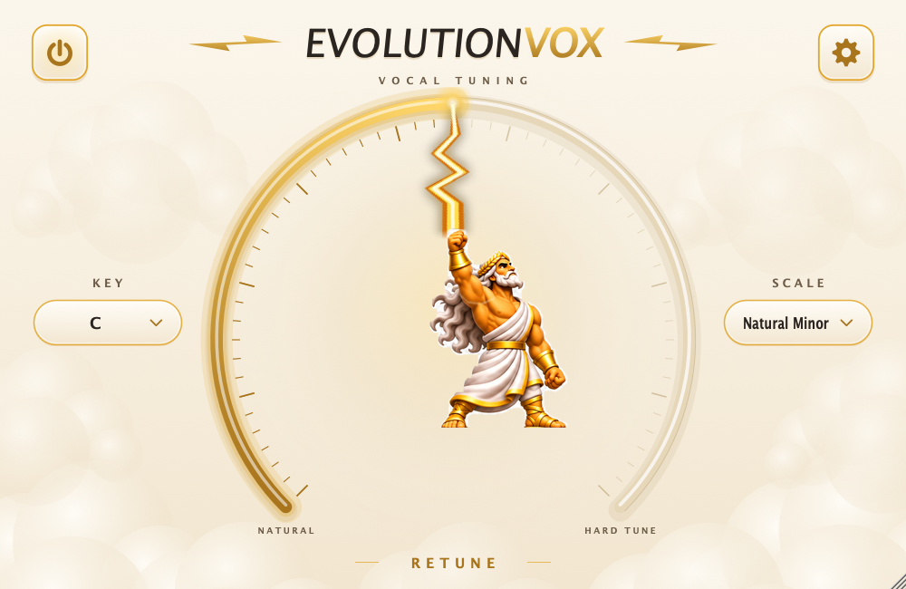

# EvolutionVox Design V1: implementation notes

Branch `design/v1-polish` (from `design/divine-white-v1-lightning-dial`). `main` (Build 0.1) is untouched.

## Main screen

The main screen has only **Power, Retune (the Zeus dial), Key, Scale and Settings**, plus the logo and the
words NATURAL / HARD TUNE / RETUNE. **The master knob shows no percentage or number**, and no background
artwork contains one.

| Control | Parameter | Notes |
| --- | --- | --- |
| Zeus lightning dial | `retune` (0–250 ms, unchanged) | Intensity 0–100% is internal only (cubic map, `RetuneDialMapping.h`). |
| Key | `key` | Unchanged. |
| Scale | `scale` | Unchanged. Custom notes are edited in Settings. |
| Power | `power` (**new**, default On) | Latency-compensated and click-free. Separate from the host's bypass. |
| Settings | (none) | Opens the advanced panel. |

How the dial responds:

- **Drag on the gold arc:** jumps to that point.
- **Drag on Zeus:** works like a vertical knob (Shift for fine control).
- **Mouse wheel:** adjusts the value.
- **Double-click:** resets to the default (8 ms).
- **Arrow, Page and Home/End keys:** step through the range.
- **Screen readers:** see a slider whose value reads in ms.

## Settings panel (all Build 0.1 features kept)

The panel holds:

- Retune Speed in **ms**, Tracking, Flex, Humanize and Transpose.
- Input Range and the factory Presets.
- The custom-scale note keyboard (active when Scale = Custom).
- The live input/target note and pitch trace.

A footer states that formant correction and throat modelling are **not** implemented. Esc or DONE closes it.

## How the lightning dial works

`Source/Plugin/ZeusRig.h` (plain C++, unit tested) is the single source of truth for the geometry:

- **Pose:** the nearest of the nine nominal intensities (0, 12, 25, 37, 50, 62, 75, 87, 100), with ±1%
  hysteresis so automation hovering on a boundary doesn't make Zeus flicker.
- **Meter point:** a 270° arc (135° → 405°) from `RetuneDialMapping::pointerDegrees`.
- **Bolt transform:** maps the bolt image's **grip to the pose's fist** and its **tip exactly onto the
  meter point**, using rotation plus scaling. The bolt *is* the pointer; there is no second knob or pointer.

At 50% the dial centre sits directly under pose 5's fist, so the bolt is vertical and its tip touches the
top of the meter. This is tested to within 0.01 px.

Each pose is drawn in this order: body without the active arm, then the independent lightning, then the
active arm (so the fist covers the grip). The arm is never rotated, so the shoulder seams stay exactly as
painted. Base + arm reproduce `complete_no_bolt` pixel-for-pixel, which the pipeline verifies.

## Asset pipeline (`tools/build_zeus_assets.py`)

- **Source:** `Assets/Zeus/source/ZeusRigV2`, the handoff copied verbatim (manifest and README kept for
  provenance).
- **Output:** `Assets/Zeus/ui/` (27 cropped PNGs, about 1.9 MB, embedded with `juce_add_binary_data`),
  `Assets/Zeus/ui/rig.json`, and the generated `Source/Plugin/ZeusRigData.h`.
- **To regenerate after any art change:** run `python3 tools/build_zeus_assets.py --preview` (needs Pillow and
  NumPy).

| Issue in Zeus Rig V2 | Fix |
| --- | --- |
| The body jumps sideways between poses (up to ±50 px) | Each pose is shifted by whole pixels so the body's centre of mass stays put (the feet baseline was already constant). |
| A stray gold fragment above pose 8's head | Islands detached from the whole figure (base ∪ arm) are removed. |
| Pose 5's bolt is clipped at the top of the canvas (tip y = −20) and has a dark ledge | Pose 5 uses the complete pose 4 bolt, re-aimed to vertical at runtime. |
| The blunt, dark-edged grip end of each bolt | The bolt fades out over the last 14 px before the fist, so the fist hides it at any angle. |
| Shoulder gaps | The arm layers are never rotated, so registration is preserved. |
| The bolt directions in the art don't follow a 270° meter | The bolt is re-aimed and length-fitted for each value: up to 0.8–1.25× uniform scale, with the rest of the change along its own axis (0.45–2.16× length overall). |

## Parameters, automation and recall (all covered by `EvolutionVoxPluginTests`)

- **Existing parameters:** all nine Build 0.1 parameter IDs, versions, order, ranges, defaults and
  normalisation are unchanged, so existing automation lanes and projects map to the same values.
- **`retune` snapping:** the 0.1 ms snapping interval was removed, so the value is now continuous. Normalised
  and stored values are unchanged. Before, the top ~7% of the dial could only reach 0.2, 0.1 or 0 ms, so the
  bolt jumped.
- **New `power` parameter:** added **last**. Migration: projects without it load with Power = On, even into
  an instance that was switched off.
- **Host bypass:** still the VST3 wrapper's own bypass, with the same VST3 parameter ID as Build 0.1. It now
  outputs dry audio delayed by the plug-in's latency instead of undelayed dry audio.

## Performance

**Audio thread:**

- No allocation, locks, image work or UI calls.
- With Power off, the tuner doesn't run at all; the output is the input delayed by the 2048-sample latency.
- Turning Power on resets the tuner, warms it up for the latency period while the dry signal plays, then
  crossfades over 20 ms.

**Adopted from `Performance_UI_0.2.patch` after measuring:**

- Coefficient caching.
- `exp2` every 16 samples, with interpolation.
- A Hann lookup table.
- No per-sample atomic loads.
- A sustain counter that uses the real hop size.

The output and test results are unchanged.

**Not adopted: the patch's detector change** (96 Hz analysis and stride-2 YIN). It is the patch's biggest
CPU saving (about 2.4× on the DSP benchmark), but it halves how often pitch is analysed (5.3 → 10.4 ms between
estimates), which can add audible lag in hard-tune. See *Decisions needed* in the PR.

**UI thread:**

- PNGs decode lazily through JUCE's shared `ImageCache`, once per process across all instances.
- Sprites are pre-scaled once per display scale and drawn as 1:1 blits.
- The meter track and the chassis are cached.
- The dial polls two atomics at 30 Hz and repaints **only when the value changes**, and then only the dirty
  rectangle (the bolt plus the changed meter segment).
- The live pitch display updates only while Settings is open. On the main screen nothing animates, so an idle
  open editor costs essentially nothing.

### Measurements (MacBook Air, Intel i5-5350U 1.8 GHz, macOS 12.7, Release build)

These are offline measurements on one machine, **not** DAW measurements. They are repeatable with
`EvolutionVoxPluginTests --bench`.

`processBlock`, stereo, as a percentage of real time on one core:

| Sample rate | 64 | 128 | 256 | 512 | 1024 |
| --- | --- | --- | --- | --- | --- |
| 44.1 kHz, Power on | 1.28 | 1.31 | 1.23 | 1.23 | 1.27 |
| 48 kHz, Power on | 1.41 | 1.35 | 1.35 | 1.33 | 1.33 |
| 96 kHz, Power on | 1.76 | 1.66 | 1.63 | 1.63 | 1.60 |
| any rate, Power off | ≤ 0.07 | | | | |

DSP-only benchmark (`evolutionvox_perf_bench`, 8 s, 48 kHz stereo): Build 0.1 took 0.120 s; this branch takes
about 0.115 s. With the patch's detector change it would take 0.051 s (not adopted).

Editor, software renderer, 1000×650: a full-window repaint takes 5.2 ms, and a full dial repaint 2.8 ms. In
normal use only the dirty rectangle is repainted, and only while the value is changing.

The DSP was never likely to be the cause of the original DAW slowdown (about 1.3% of one core). The Build 0.1
editor, however, called `setColour` on all 12 note buttons 20 times a second, and each call repaints a button.
Those repaints merged with the pitch-plot repaint into a large region redrawn 20 times a second while the
window was open. That is gone. Confirming the DAW behaviour needs a measurement in your DAW (see the test plan
in the PR).

## Known limitations

- **Source art:** pose 8's toga and pose 9's torso, toga and legs have rectangular, stair-stepped holes in the
  alpha mask (a block-mask background removal). The holes contain no colour, so they can't be repaired
  without new art. There is also a white matte fringe around every pose; it's invisible on ivory but would
  show on a dark background.
- **The poses are regenerated art,** not pixel-identical to the previously approved illustration (per the
  handoff). They need art-direction sign-off.
- **The bolt is re-aimed, not redrawn per angle.** At some values (around 25–31% and 87–100%) it points well
  away from how it was painted, and it is stretched up to about 2.2× near 0%.
- **Hard tune saturates early:** above about 87% intensity (below 0.5 ms) the DSP already behaves as
  instant hard tune, so the last part of the arc sounds identical (the existing DSP behaviour).
- **No DAW testing yet:** the VST3 builds and the headless tests pass, but it hasn't been checked inside a
  DAW, and DAW CPU hasn't been measured.
- **No AU format:** VST3 only, as before.
